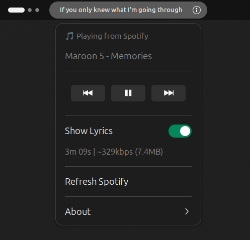

# Spotline (with Quality Sync & Full View App)

A GNOME Shell extension and native Ubuntu desktop app that displays the currently playing Spotify song and real-time synchronized lyrics directly in your top panel and in a full dual-pane view, along with live audio quality stream metrics.

---

## 📸 Screenshots

### Top Bar Display


### Dropdown Menu & Quality Metrics


---

## ✨ Features & Improvements

- **Full View Ubuntu App (Standalone Desktop Experience)**:
  - Open instantly with one click on the **"✨ Open Spotline App"** button right below the About menu, or from the Ubuntu application launcher.
  - Features an aesthetic, modern music icon registered natively with Ubuntu's desktop environment (`spotline-lyrics.desktop`).
  - **Full Screen Mode**: Covers the entire display for an immersive music & lyrics experience. Toggle anytime via the header button, Settings dialog, or by pressing <kbd>F11</kbd> / <kbd>Esc</kbd>.
  - **Left Pane**: Centered square artwork from Spotify (`mpris:artUrl`), track title, Google Pixel Material You animated squiggly wave progress bar, and minimal playback controls (Previous, Play/Pause toggle, and Next).
  - **Right Pane**: Karaoke-style synchronized lyrics with bright highlighting for the active lyric line, dimmed background lyrics, interactive line-click seeking (click any lyric to jump playback), and ultra-smooth 60 FPS kinetic auto-scrolling.
  - **Change Lyrics Selector**: Queries LRCLIB v2 for top search candidates, filters out identical duplicate lyrics, shows major language badges (e.g. Tamil, English), and provides one-click radio selection with green/red sync status dots.
  - **Display Settings**: Adjustable glass tint opacity, lyrics font size (16px to 36px), and background gradient glow saved in `~/.config/spotline/preferences.json`.

- **Upgraded LRCLIB v2 (Beta) Integration**:
  - Migrated to the new lightweight `/api/v2/search` endpoint + `/api/get/{id}` fetching in both the GNOME extension and the full desktop app.
  - Filters candidates within $\pm 5$ seconds duration drift and sorts by closest duration match to the active Spotify song.
  - Automatically prioritizes entries with `hasSyncedLyrics === true`, gracefully falling back to plain lyrics when synced versions are unavailable.
  - **Resilient Retry Polling**: Staggered backup retries (1s, 3s, 6s, 12s) up to 30 seconds gracefully handle transient API 503 or network errors.

- **Added Quality Inspector (Zero-Debug Native)**:
  - Verifies real download payload sizes and content bitrates **directly inside GNOME Shell** without requiring Spotify debug flags, wrapper scripts, or external Python daemons.
  - Inspects active Spotify file descriptors in Linux `/proc/<pid>/fd/` and cursor positions (`pos:`) to identify the exact audio file in real time.
  - **1.0-Second Stability Sampling**: Flags tracks as `Buffering (<size>MB)` during downloads so premature bitrates are never shown, calculating accurate bitrate once bytes stabilize.
  - **10-Second Stream Polling**: Non-blocking periodic checks detect chunk growth on long tracks/podcasts and dynamically refresh metrics.

- **Scrolling Animations**:
  - **Horizontal Slide (Title $\rightarrow$ Lyrics)**: When a song starts, the title appears immediately. As soon as synced lyrics are loaded, the title slides out to the left and the first lyric slides smoothly in from the right.
  - **Vertical Roll (Line $\rightarrow$ Line)**: Subtle vertical roll transitions animate subsequent lyric lines as playback advances.

- **Duration & Live Stream Metrics**:
  - Displays formatted song duration alongside real measured bitrate and stream cache size directly in the dropdown menu:
    ```text
    {duration} | ~{bitrate}kbps ({size}MB)
    ```
    *(e.g., `4m 55s | ~316kbps (11.1MB)`)*

- **Spotify-Exclusive Tracking & Clean Panel Presence**:
  - Exclusively monitors Spotify via MPRIS (`org.mpris.MediaPlayer2.spotify`), ignoring browser media sessions or other audio players.
  - Automatically hides from the top bar when Spotify is closed or not running—no clutter or empty placeholder text.

- **Interactive Playback Controls**:
  - Control Spotify directly from the panel menu and the full view app with Prev, Play/Pause, and Next buttons.

---

## 🚀 Installation

### User Installation (Recommended):

```bash
mkdir -p ~/.local/share/gnome-shell/extensions/spotify-lyrics-ext@devic1
cp -r * ~/.local/share/gnome-shell/extensions/spotify-lyrics-ext@devic1/
```

### Reloading the Extension:

- **On GNOME on Xorg (X11)**:
  Press `Alt + F2`, type `r`, and press `Enter`.
- **On Wayland**:
  Log out and log back in.

### Enable the Extension:

```bash
gnome-extensions enable spotify-lyrics-ext@devic1
```

Or enable it via the **GNOME Extensions** application.

---

## 🛠️ Development & Debugging

### View Extension Logs:
```bash
journalctl -f -o cat /usr/bin/gnome-shell | grep -i spotify
```

### Verify MPRIS Connection:
```bash
dbus-send --print-reply --dest=org.mpris.MediaPlayer2.spotify /org/mpris/MediaPlayer2 org.freedesktop.DBus.Properties.Get string:org.mpris.MediaPlayer2.Player string:Metadata
```

---

## 👏 Credits & Acknowledgements

* **Original Creator**: [d3osaju](https://github.com/d3osaju/Spotline) for creating the original Spotline / Music Lyrics extension.
* **Enhancements & Fork**: [devic1](https://github.com/devic1/Spotline-with-quality-sync) for adding the native zero-debug quality inspector, periodic stream polling, accurate duration-matched lyrics finder, right-to-left slide animation, and duration metrics.

